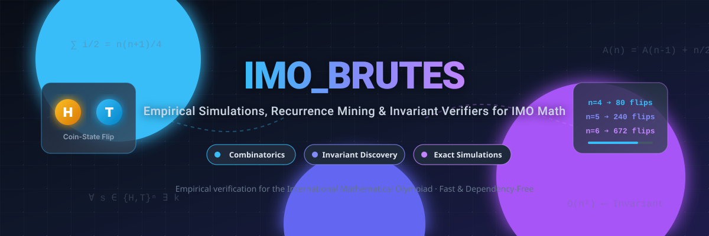

<div align="center">

<a href="https://github.com/ishandutta2007/imo_brutes">
  
</a>

# 🧠 imo_brutes: IMO Problem Simulators &amp; Empirical Brute-Forcers

**High-performance Python brute-force simulations, recurrence mining, and invariant verifications for International Mathematical Olympiad (IMO) problems.**

<br/>

<a href="https://github.com/ishandutta2007/Awesome-Awesome-Awesome"></a><a href="https://discord.gg/jc4xtF58Ve"></a>
[](LICENSE)
[](https://www.python.org/downloads/)
[](https://github.com/ishandutta2007/imo_brutes)
[](https://github.com/ishandutta2007/imo_brutes/commits/main)
[](https://github.com/ishandutta2007/imo_brutes/stargazers)
<a href="https://github.com/ishandutta2007"></a>

<br/>

[📖 Overview](#-overview) •
[🧩 Problems Included](#-problems-included) •
[🚀 Getting Started](#-getting-started) •
[🔬 Methodology](#-methodology) •
[🤝 Contributing](#-contributing) •
[📈 Star History](#-star-history) •
[📜 License](#-license)

</div>

---

## 📖 Overview

Many **International Mathematical Olympiad (IMO)** problems in combinatorics, discrete mathematics, and game theory are deceptively difficult to tackle analytically at first glance. 

`imo_brutes` provides exact computational simulations to:
- 🧪 **Stress-test edge cases** and confirm problem statement edge dynamics.
- 🔍 **Reveal hidden monovariants & invariants** that govern state transitions.
- 📊 **Exhaustively evaluate small $n$ cases** to uncover closed-form sequences and recurrence relations ($A(n)$, $S(n)$).
- 💡 **Formulate airtight conjectures** before formal induction proofs or paper submissions.

All scripts are written in clean, dependency-free Python with clear algorithmic models.

---

## 🧩 Problems Included

### 🪙 1. IMO 2019 — Problem 5 (The Bank of Bath Coin-Flipping Game)

- **Source File**: [`imo_2019_P5_brute.py`](file:///C:/Users/ishan/Documents/Projects/imo_brutes/imo_2019_P5_brute.py)
- **Problem Statement**:
  > The Bank of Bath issues coins with an $H$ on one side and a $T$ on the other. There are $n$ coins placed in a line from left to right.
  > In each step, if there are $k > 0$ coins showing $H$, the $k$-th coin from the left is flipped:
  > - If it was $H$, it turns into $T$ and the pointer shifts left ($k - 1$).
  > - If it was $T$, it turns into $H$ and the pointer shifts right ($k + 1$).
  >
  > The game terminates when all coins show $T$ ($k = 0$). Does the process always terminate, and what is the expected number of steps over all $2^n$ configurations?

#### 📊 Empirical Simulation Results

Simulating every permutation across $\{H, T\}^n$ yields exact step totals and averages:

| $n$ | Total Configurations ($2^n$) | Total Flip Steps $S(n)$ | Average Steps $A(n) = \frac{S(n)}{2^n}$ | Terminated (All $T$) |
|:---:|:----------------------------:|:-----------------------:|:---------------------------------------:|:--------------------:|
| **1** | 2 | 1 | **0.5** | ✅ 100% |
| **2** | 4 | 6 | **1.5** | ✅ 100% |
| **3** | 8 | 24 | **3.0** | ✅ 100% |
| **4** | 16 | 80 | **5.0** | ✅ 100% |
| **5** | 32 | 240 | **7.5** | ✅ 100% |
| **6** | 64 | 672 | **10.5** | ✅ 100% |

#### 🧮 Recurrence & Closed-Form Solution

Examining the progression of $A(n)$:
$$A(1) = 0.5,\quad A(2) = 1.5,\quad A(3) = 3.0,\quad A(4) = 5.0,\quad A(5) = 7.5,\quad A(6) = 10.5$$

The difference sequence $\Delta A(n) = A(n) - A(n-1) = \frac{n}{2}$ gives the recurrence:
$$A(n) = A(n-1) + \frac{n}{2}$$

Summing this telescoping series with base condition $A(0) = 0$:
$$A(n) = \sum_{i=1}^n \frac{i}{2} = \frac{n(n+1)}{4}$$

Total operations across all $2^n$ starting configurations:
$$S(n) = 2^n \cdot A(n) = n(n+1) \cdot 2^{n-2}$$

---

## 🚀 Getting Started

### 📋 Prerequisites

- **Python 3.10+** (only uses Python standard library modules like `itertools`)
- No external packages or heavyweight frameworks required.

### 💻 Installation & Usage

1. **Clone the repository**:
   ```bash
   git clone https://github.com/ishandutta2007/imo_brutes.git
   cd imo_brutes
   ```

2. **Execute the simulation**:
   ```bash
   python imo_2019_P5_brute.py
   ```

3. **Output**:
   ```text
   1 => 1 2 0.5
   2 => 6 4 1.5
   3 => 24 8 3.0
   4 => 80 16 5.0
   5 => 240 32 7.5
   6 => 672 64 10.5
   ```

---

## 🔬 Methodology

```
┌─────────────────────────┐
│ IMO Problem Statement   │
└────────────┬────────────┘
             │
             ▼
┌─────────────────────────┐
│ Exhaustive State Space  │ ──► Models transitions & bounds
└────────────┬────────────┘
             │
             ▼
┌─────────────────────────┐
│ Python Simulation Loop  │ ──► Tracks flip steps, cycles & halts
└────────────┬────────────┘
             │
             ▼
┌─────────────────────────┐
│ Pattern & OEIS Mining   │ ──► Recurrences A(n) = A(n-1) + n/2
└────────────┬────────────┘
             │
             ▼
┌─────────────────────────┐
│ Formal Proof Conjectures│ ──► Closed-form: n(n+1)/4
└─────────────────────────┘
```

---

## 🤝 Contributing

Contributions of new IMO, USAMO, Putnam, or RMM brute-force scripts are welcome!

1. 🍴 Fork the repository.
2. 🌿 Create your feature branch (`git checkout -b feature/imo-year-px`).
3. 📝 Follow standard naming: `imo_<year>_P<problem>_brute.py`.
4. 💬 Include problem descriptions, invariants, and test outputs in the header comments.
5. 🚀 Open a Pull Request.

---

## 📈 Star History

[](https://star-history.dera.page/#ishandutta2007/imo_brutes&type=date&legend=top-left)

---

## 📜 License

This project is open-source and distributed under the [MIT License](LICENSE).
